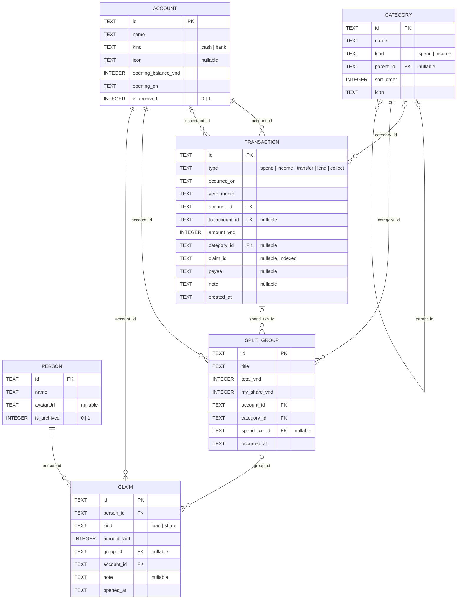

# Database ERD

`TRANSACTION.claim_id` has an index but no declared foreign-key constraint.
`SPLIT_GROUP.spend_txn_id` references `TRANSACTION.id`; a null value is allowed
when the split group's `my_share_vnd` is zero.
